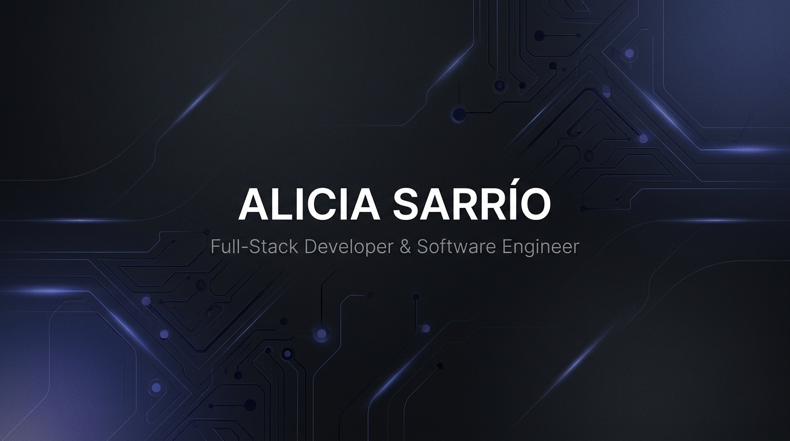

  

   

  <h1>Hola, soy Alicia Sarrío 👋</h1>
  
<strong>Ingeniera de Software & Full-Stack Developer</strong>

  
Graduada en <strong>Ingeniería Informática</strong> por la <strong>Universidad Politécnica de Valencia (UPV)</strong> Especialidad en <em>Ingeniería del Software</em>

  

    
    
    
  

---

### 🚀 Sobre mí

- 🎓 Graduada en **Ingeniería Informática** en la **UPV**, especializada en el ciclo de vida completo del software, patrones de diseño y arquitecturas escalables.
- 💻 Desarrollo aplicaciones web de extremo a extremo (**Full-Stack**) con foco en rendimiento, usabilidad y código limpio (*Clean Code* & *SOLID*).
- 🛠️ Experiencia sólida tanto en entornos **Frontend** reactivos como en **Backend** robusto y tipado.
- 📦 Interés continuo en containerización (**Docker**), integración continua y diseño de interfaces con **Figma**.
- 🌱 Siempre aprendiendo y perfeccionando buenas prácticas de ingeniería de software.

---

### 💻 Stack Tecnológico

  

 

| Área | Tecnologías & Herramientas |
| :--- | :--- |
| **Frontend** |     |
| **Backend** |     |
| **Bases de Datos & DevOps** |   |
| **Entorno & Herramientas** |      |

---

### 📊 Estadísticas de GitHub

  
  &nbsp;&nbsp;
  

 

  

---

### 📂 Proyectos Destacados

<!-- Puedes reemplazar estos ejemplos con los repositorios que quieras destacar -->

<table>
  <tr>
    <td width="50%" valign="top">
      <h4>📌 <a href="https://github.com/aliciiasarrio">Proyecto Destacado 1</a></h4>
      
<em>Descripción concisa de la aplicación: problema que soluciona, arquitectura empleada y principales funcionalidades.</em>

      

        
        
        
      

      
<a href="https://github.com/aliciiasarrio">🔗 Ver repositorio & demo →</a>

    </td>
    <td width="50%" valign="top">
      <h4>📌 <a href="https://github.com/aliciiasarrio">Proyecto Destacado 2</a></h4>
      
<em>API / Servicio backend con arquitectura en capas, autenticación segura y persistencia de datos.</em>

      

        
        
        
      

      
<a href="https://github.com/aliciiasarrio">🔗 Ver repositorio & demo →</a>

    </td>
  </tr>
</table>

---

### 📫 Conectemos

  ¿Quieres colaborar en algún proyecto, tienes preguntas o buscas talento Full-Stack? 
  No dudes en escribirme a <a href="mailto:sarriocolomaralicia@gmail.com"><strong>sarriocolomaralicia@gmail.com</strong></a>

  

